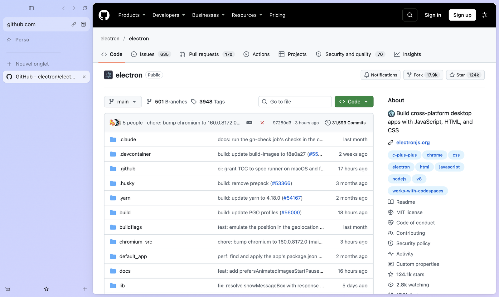

# Browsy

Un navigateur pour macOS inspiré d'[Arc](https://arc.net), construit sur Electron (donc sur Chromium).



Arc n'évolue plus. Browsy reprend ce qui le rend agréable au quotidien (sidebar verticale, Spaces, onglets épinglés, Command bar, Peek, mini-fenêtre…) dans un navigateur que l'on peut lire, modifier et compiler soi-même. Il vise d'abord un usage de développeur : extensions Chrome, DevTools, Developer Mode pour `localhost`.

> **État du projet** : usage personnel, version 0.0.1. Browsy fonctionne au quotidien, mais il n'est ni signé ni notarisé, et il n'existe pas de version téléchargeable : on le compile depuis les sources. L'interface est en français.

## Sommaire

- [Installation](#installation)
- [À quoi ça sert](#à-quoi-ça-sert)
- [Fonctionnalités](#fonctionnalités)
- [Raccourcis clavier](#raccourcis-clavier)
- [Limites connues](#limites-connues)
- [Développement](#développement)
- [Architecture](#architecture)

## Installation

### Prérequis

- **macOS sur Apple Silicon** (M1 ou plus récent). Le paquet est construit pour `arm64` uniquement.
- **Node.js 22** ou plus récent, avec npm.
- **Git**.

### Compiler et installer l'application

```sh
git clone <url-du-dépôt> Browsy
cd Browsy
npm install          # télécharge aussi le binaire Electron
npm run install-app  # compile, empaquette et copie Browsy.app dans /Applications
```

`npm run install-app` enchaîne trois étapes :

1. `electron-vite build` compile le processus principal, les preloads et l'interface React dans `out/` ;
2. `electron-builder` produit `dist/mac-arm64/Browsy.app` ;
3. [scripts/install-app.sh](scripts/install-app.sh) remplace `/Applications/Browsy.app` par cette nouvelle version.

Quitte Browsy avant de lancer la commande : le script refuse d'écraser une application ouverte.

Pour seulement produire l'application sans l'installer : `npm run package`, puis ouvre `dist/mac-arm64/Browsy.app`.

### Premier lancement

- L'application a une signature ad hoc, sans certificat Apple. Compilée sur ta machine, elle se lance normalement. Si tu la copies sur un autre Mac, macOS la bloquera : clic droit sur l'application, puis **Ouvrir**.
- Si Arc est installé, Browsy propose d'importer tes Spaces, onglets épinglés, favoris et règles de liens (voir [Import depuis Arc](#import-depuis-arc)). Tu peux aussi le faire plus tard : **Fichier › Importer depuis Arc…**.
- Pour en faire ton navigateur par défaut : menu **Browsy › Définir comme navigateur par défaut** (ou **Réglages › Général**). macOS demande une confirmation. Cette option ne fonctionne qu'avec l'application installée, pas en mode développement.

### Mettre à jour

```sh
git pull
npm install
npm run install-app
```

Pour récupérer les derniers correctifs de sécurité de Chromium sans attendre une mise à jour du dépôt :

```sh
npm run upgrade
```

[scripts/upgrade.sh](scripts/upgrade.sh) passe Electron et les bibliothèques d'extensions à leur dernière version stable, vérifie les types, lance les tests, puis recompile et réinstalle l'application.

### Où sont mes données ?

Tout est stocké en local dans `~/Library/Application Support/Browsy/` :

| Fichier ou dossier | Contenu |
|---|---|
| `browsy-state.json` | Spaces, onglets, favoris, archive et réglages |
| `history.sqlite` | Historique de navigation (recherche plein texte) |
| `Extensions/`, `Profiles/<id>/Extensions/` | Extensions installées, par profil |
| `Partitions/` | Cookies, connexions et stockage des sites, un dossier par profil |

Pour désinstaller : supprime `/Applications/Browsy.app` et ce dossier.

## À quoi ça sert

Browsy est un navigateur complet : il affiche les sites comme Google Chrome (même moteur, même user-agent), installe les extensions du Chrome Web Store et gère plusieurs profils isolés. Ce qui change, c'est l'organisation :

- les onglets sont dans une **sidebar verticale**, pas en haut de la fenêtre ;
- ils sont rangés dans des **Spaces** (Perso, Travail, un projet…), chacun avec ses couleurs, son icône et éventuellement son propre profil ;
- les onglets **épinglés** restent ; les onglets **du jour** s'archivent seuls au bout d'un délai, pour ne pas s'accumuler ;
- tout se pilote au clavier depuis la **Command bar** (⌘T).

Si tu viens d'Arc, tu retrouveras les mêmes gestes et les mêmes raccourcis, et l'import récupère ton organisation.

## Fonctionnalités

### Sidebar et Spaces

- **Spaces** : groupes d'onglets indépendants, avec un thème (une à trois couleurs en dégradé, grain, clair/sombre/auto) et une icône (emoji ou icône intégrée). On passe de l'un à l'autre en glissant deux doigts sur le trackpad, avec ⌃1 à ⌃9, ou ⌥⌘← / ⌥⌘→.
- **Favorites** : la rangée d'icônes en haut de la sidebar, partagée par tous les Spaces d'un même profil.
- **Onglets épinglés** : restent d'une session à l'autre, rangeables en **dossiers**. Un onglet épinglé garde son adresse d'origine pour y revenir, et peut être renommé.
- **Onglets du jour** : sous le séparateur, du plus récent au plus ancien. Archivés automatiquement après 12 h, 24 h, 7 jours… ou jamais, réglable globalement et par Space (clic droit sur le Space).
- **Archive** : les onglets archivés restent consultables et restaurables (bouton en bas de la sidebar).
- **Sidebar** à gauche ou à droite, redimensionnable, masquable (⌘S). Masquée, elle réapparaît au survol du bord de la fenêtre.

### Navigation

- **Command bar** (⌘T, ⌘L) : saisie d'une adresse ou d'une recherche, suggestions tirées de l'historique et des onglets ouverts, accès aux commandes du navigateur.
- **Moteurs de recherche** : Google, DuckDuckGo, Bing, Ecosia, Kagi, Qwant ou Perplexity.
- **Split View** (⌃⇧=) : deux à quatre onglets côte à côte, une seule ligne dans la sidebar, proportions ajustables.
- **Peek** : depuis un onglet épinglé ou un favori, un lien vers un autre site s'ouvre dans un panneau par-dessus la page, sans quitter l'onglet.
- **Mini-fenêtre** (⌥⌘N) : petite fenêtre pour un lien rapide ; ⌘O la transforme en onglet sans recharger la page.
- **Air Traffic Control** : règles qui décident où s'ouvrent les liens venus d'autres applications (un Space donné, le dernier Space utilisé ou une mini-fenêtre), selon le domaine ou un texte contenu dans l'adresse. Réglages › Liens.
- **Contrôles du site** (icône dans la barre d'adresse) : sécurité de la connexion, copie du lien (y compris en Markdown), zoom, permissions accordées au site.
- **Picture-in-Picture automatique** : une vidéo en lecture passe en fenêtre flottante quand on change d'onglet (désactivable).
- **Historique** (⌘Y), **téléchargements** (⌥⌘L), recherche dans la page (⌘F), réouverture du dernier onglet fermé (⇧⌘T), impression.
- **Fenêtres multiples** et **navigation privée** (⇧⌘N, sans extensions ni historique).

### Profils et extensions

- **Profils** : chaque profil a sa propre session (cookies, connexions, stockage, extensions). Chaque Space est rattaché à un profil, ce qui permet par exemple un Space « Travail » connecté au compte Google pro. Réglages › Profils.
- **Extensions Chrome** : installation et suppression directement depuis le [Chrome Web Store](https://chromewebstore.google.com), popups, icônes épinglables dans la barre d'adresse. Testées : uBlock Origin, AdGuard, LastPass, Wappalyzer, Redux DevTools, entre autres.
- **Identité Chrome** : user-agent et Client Hints identiques à Google Chrome, pour que les sites (connexion Google notamment) ne refusent pas le navigateur.
- **Permissions** : comme Chrome, Browsy demande avant d'autoriser un site à utiliser la caméra, le micro, la position, les notifications… et mémorise la réponse par site.

### Pour les développeurs

- **Developer Mode** (⌥⌘D), toujours actif sur `localhost` : une barre au-dessus de la page affiche l'URL complète, le nombre d'erreurs et d'avertissements de la console, et des boutons pour recharger et ouvrir les DevTools.
- **DevTools** (⌥⌘I), code source (⌥⌘U), rechargement sans cache (⇧⌘R).
- **Copie de l'URL** (⇧⌘C) ou de l'URL en lien Markdown (⌥⇧⌘C).

### Personnalisation

- **Réglages** (⌘,) : Général, Profils, Raccourcis, Liens, Avancé.
- **Raccourcis personnalisables** : toutes les commandes des menus peuvent être réassignées, avec détection des conflits.
- **Thème par Space** : éditeur de couleurs, grain et apparence (Spaces › Thème et icône du Space…).

### Import depuis Arc

Browsy lit (sans jamais les modifier) les fichiers d'Arc dans `~/Library/Application Support/Arc/` et importe :

- les Spaces, avec leurs thèmes et icônes ;
- les onglets épinglés, dossiers et Split Views ;
- les favoris ;
- les extensions épinglées ;
- les sites en Developer Mode ;
- les règles d'Air Traffic Control.

L'import s'ajoute à l'état existant, il n'efface rien. Les extensions elles-mêmes ne sont pas copiées : réinstalle-les depuis le Chrome Web Store.

## Raccourcis clavier

Les principaux raccourcis par défaut, tous modifiables dans Réglages › Raccourcis :

| Action | Raccourci |
|---|---|
| Nouvel onglet (Command bar) | ⌘T |
| Modifier l'URL | ⌘L |
| Fermer l'onglet | ⌘W |
| Rouvrir l'onglet fermé | ⇧⌘T |
| Épingler / désépingler | ⌘D |
| Onglet 1 à 8 / dernier onglet | ⌘1 … ⌘9 |
| Onglet suivant / précédent | ⌃Tab / ⌃⇧Tab |
| Space 1 à 9 | ⌃1 … ⌃9 |
| Space suivant / précédent | ⌥⌘→ / ⌥⌘← |
| Afficher / masquer la sidebar | ⌘S |
| Split View | ⌃⇧= |
| Nouvelle fenêtre / fenêtre privée | ⌘N / ⇧⌘N |
| Mini-fenêtre | ⌥⌘N |
| Copier l'URL / en Markdown | ⇧⌘C / ⌥⇧⌘C |
| Rechercher dans la page | ⌘F |
| Historique | ⌘Y |
| Téléchargements | ⌥⌘L |
| Developer Mode pour ce site | ⌥⌘D |
| Outils de développement | ⌥⌘I |
| Afficher le code source | ⌥⌘U |
| Recharger / sans cache | ⌘R / ⇧⌘R |
| Zoom avant / arrière / taille réelle | ⌘+ / ⌘- / ⌘0 |
| Plein écran | ⌃⌘F |
| Réglages | ⌘, |

## Limites connues

- **Pas de DRM Widevine** : Netflix, Spotify web, Disney+ et les autres services de streaming protégés ne lisent pas leurs vidéos. Electron n'inclut pas Widevine.
- **macOS Apple Silicon uniquement** pour l'instant, et application non notarisée.
- **Pas de mise à jour automatique** : il faut recompiler (voir [Mettre à jour](#mettre-à-jour)).
- **Pas de synchronisation** entre appareils.
- **Passkeys et Touch ID** non vérifiés : WebAuthn peut ne pas proposer l'authentificateur de la plateforme.
- **Extensions Manifest V2** (ancien format) : elles se chargent, mais Chromium les abandonne progressivement.
- La liste des points validés et de ceux qui restent à tester est tenue dans [PHASE0.md](PHASE0.md).

## Développement

### Lancer en mode développement

```sh
npm install
npm run dev
```

L'interface se recharge à chaud à chaque modification de `src/renderer/`. Les changements dans `src/main/` relancent l'application.

> **Attention** : `npm run dev` utilise par défaut le même profil que l'application installée (`~/Library/Application Support/Browsy/`). Pour expérimenter sans toucher à tes onglets et à tes connexions, isole le profil :
>
> ```sh
> BROWSY_USER_DATA=/tmp/browsy-test npm run dev
> ```

### Scripts npm

| Commande | Rôle |
|---|---|
| `npm run dev` | Lance Browsy en mode développement |
| `npm run dev:arc` | Idem, en chargeant en lecture seule les extensions installées dans Arc |
| `npm run build` | Compile dans `out/` |
| `npm start` | Lance la version compilée de `out/` |
| `npm run typecheck` | Vérifie les types TypeScript |
| `npm test` | Lance les tests (Vitest) |
| `npm run package` | Produit `dist/mac-arm64/Browsy.app` |
| `npm run install-app` | Produit l'application et l'installe dans `/Applications` |
| `npm run upgrade` | Met Electron et les bibliothèques d'extensions à jour, puis réinstalle |

### Variables d'environnement

Outils de développement et de test, tous facultatifs :

| Variable | Effet |
|---|---|
| `BROWSY_USER_DATA=<dossier>` | Utilise un profil séparé (indispensable pour les tests automatisés) |
| `BROWSY_START_URL=<url>` | Ouvre cette adresse dans un onglet au démarrage |
| `BROWSY_LOAD_EXTENSION=<dossier>` | Charge une extension non empaquetée |
| `BROWSY_ARC_EXTENSIONS=1` | Charge les extensions installées dans Arc (utilisé par `npm run dev:arc`) |
| `BROWSY_CAPTURE=<préfixe>` | Enregistre des captures PNG de l'interface et de l'onglet, sans permission d'enregistrement d'écran |
| `BROWSY_SCENARIO=<noms>` | Avec `BROWSY_CAPTURE` : scénarios de captures (`ui`, `site-controls`, `extensions`, `toast`, `floating`, `fullscreen`, `swipe`, `theme`, `settings`, `private`, `little`, `peek`), séparés par des virgules |
| `BROWSY_PROBE_SCRIPT=<fichier.js>` | Avec `BROWSY_START_URL` et `BROWSY_CAPTURE` : exécute ce script dans la page, puis capture à nouveau |
| `BROWSY_PROBE_CLICK=<x>,<y>` | Simule un clic dans la page après le script |
| `BROWSY_DEBUG_SW=1` | Affiche la console des service workers des extensions |

La capture en haut de ce fichier a été produite ainsi :

```sh
BROWSY_USER_DATA=/tmp/browsy-capture \
BROWSY_START_URL=https://github.com/electron/electron \
BROWSY_CAPTURE=/tmp/browsy BROWSY_SCENARIO=ui \
npm run dev
```

### Tests

```sh
npm test
```

Les tests couvrent la logique pure, sans Electron : le modèle de données ([tests/model.test.ts](tests/model.test.ts)), la mise en page des Split Views ([tests/layout.test.ts](tests/layout.test.ts)), le geste de glissement entre Spaces ([tests/swipeTracker.test.ts](tests/swipeTracker.test.ts)) et l'import depuis Arc ([tests/arcImport.test.ts](tests/arcImport.test.ts)). [tests/arcImport.real.test.ts](tests/arcImport.real.test.ts) lit les vraies données d'Arc si elles sont présentes sur la machine.

## Architecture

Browsy n'est pas un fork de Chromium : c'est une application Electron, ce qui garde le code court (environ 7 700 lignes de TypeScript) et permet de suivre les versions de Chromium en mettant simplement Electron à jour.

- **Electron** fournit Chromium et Node.js ; chaque page web est une `WebContentsView` isolée (sandbox, `contextIsolation`).
- **[electron-chrome-extensions](https://github.com/samuelmaddock/electron-browser-shell)** implémente les API `chrome.*` dont les extensions ont besoin, et **electron-chrome-web-store** l'installation depuis le Web Store.
- **React 19** pour l'interface (sidebar, Command bar, réglages), servie par **electron-vite**.
- **SQLite** (`node:sqlite`, recherche FTS5) pour l'historique ; un fichier JSON écrit de façon atomique pour le reste.

```
src/
├── main/          Processus principal (Node.js)
│   ├── index.ts         Démarrage, IPC, liens externes
│   ├── App.ts           Fenêtres, profils, état global
│   ├── Browser.ts       Une fenêtre : onglets, Spaces, Peek, overlays, actions
│   ├── TabViews.ts      Vues des onglets et Split Views
│   ├── LittleWindow.ts  Mini-fenêtre
│   ├── commands.ts      Registre des commandes (menus, raccourcis, Command bar)
│   ├── profiles.ts      Une session par profil, extensions, Web Store
│   ├── chromeIdentity.ts  User-agent et Client Hints de Chrome
│   ├── permissions.ts   Demandes de permissions par site
│   ├── arcImport.ts     Import depuis Arc
│   ├── history.ts       Historique SQLite
│   └── store.ts         Sauvegarde de l'état
├── preload/       Ponts entre l'interface et le processus principal, correctifs de compatibilité des extensions
├── renderer/      Interface React (sidebar, Command bar, réglages, éditeur de thème…)
└── shared/        Code commun : modèle de données, IPC, recherche, mise en page
```

Le modèle de données ([src/shared/model.ts](src/shared/model.ts)) reprend celui d'Arc : un **profil** est une session isolée ; un **Space** appartient à un profil et contient des onglets épinglés (avec dossiers et Split Views) et des onglets du jour ; les **Favorites** sont partagés par les Spaces d'un même profil. Ce sont des fonctions pures, testées sans Electron.
